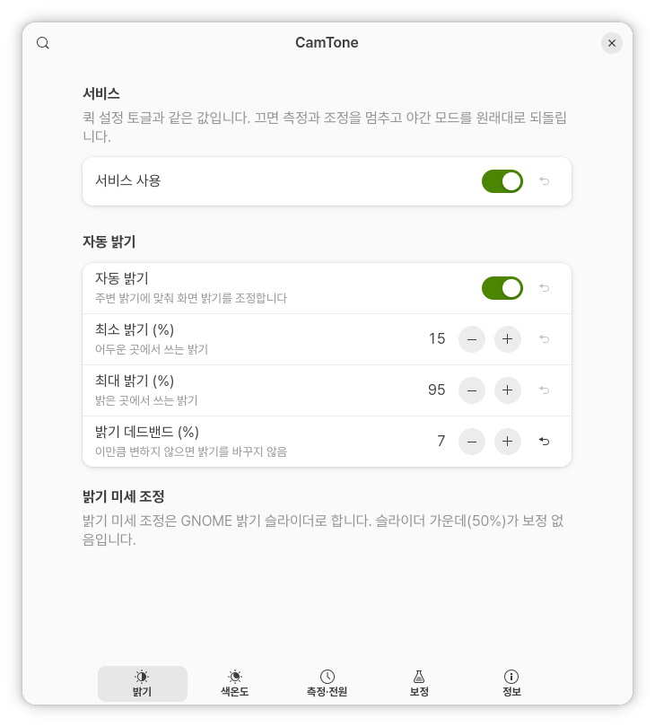
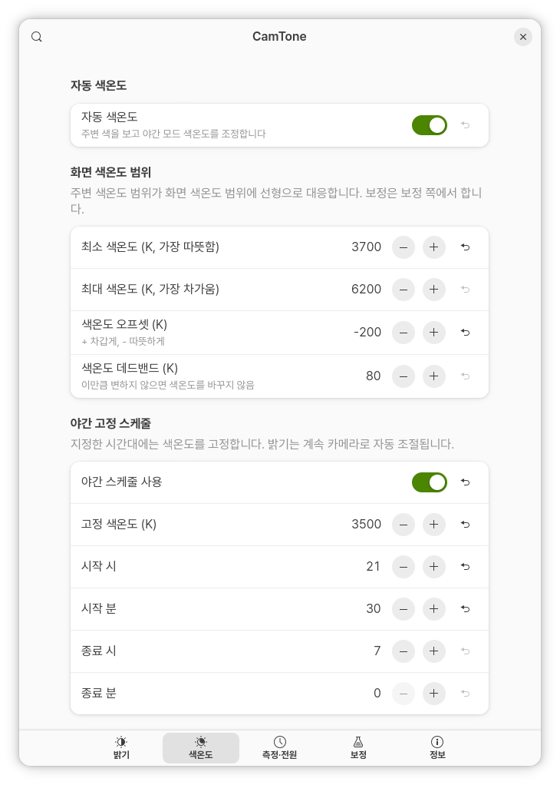
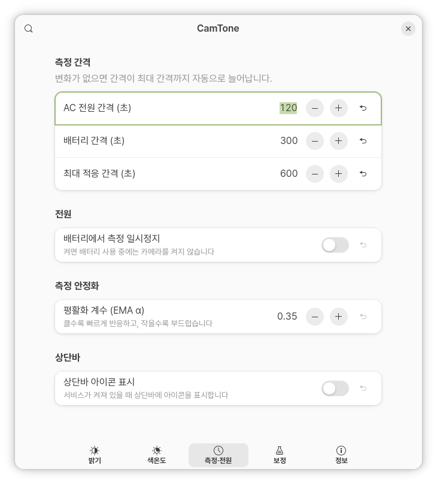
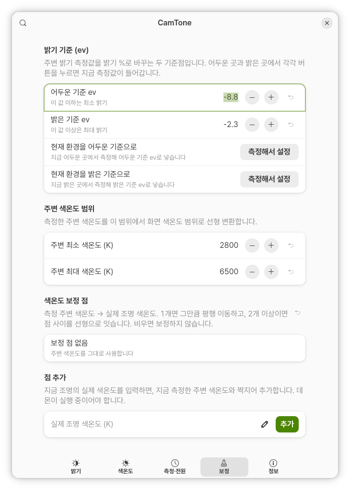
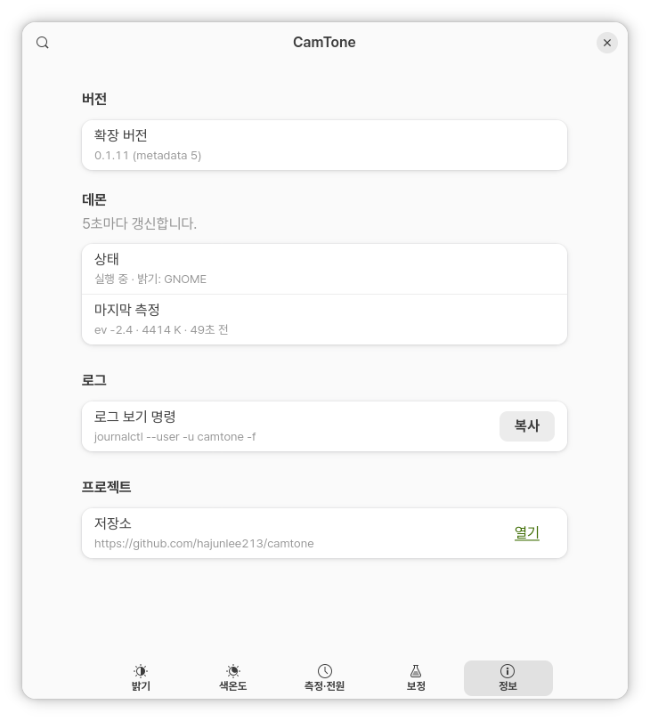

# CamTone

**English** | [한국어](README.ko.md)

CamTone uses a laptop webcam (`/dev/video0`) as an **ambient light sensor (ALS) and a color temperature sensor (RGB/CCT)**. On GNOME Wayland, it adjusts screen brightness and the Night Light temperature to match your surroundings. It is a software stand-in for laptops that have no color sensor.

> The project used to be called `webcam-as-als-rgb`. It became CamTone in v0.1.10. `./install.sh` cleans up an older installation and moves its settings to the new name.

The Python daemon and the GNOME Shell extension come as one package. A single Quick Settings toggle turns it on and off. When it is off, no process is left running and Night Light goes back to its original value.

## Screenshots

Preferences window. The UI is in English; these screenshots were taken with the Korean translation.

| Brightness | Color temperature | Measuring & Power |
| :---: | :---: | :---: |
|  |  |  |
| **Calibration** | **About** | |
|  |  | |

---

## 1. How it works

In its default mode (`auto_exposure=3`, `white_balance_automatic=1`), a typical UVC webcam corrects gain and white balance by itself. Its picture looks about the same whatever the room brightness or light color. So CamTone measures like this:

1. **Manual exposure + auto-ranging (`auto_exposure=1`)**
   * Auto exposure is turned off and `exposure_time_absolute` is set directly.
   * Exposure is adjusted in up to 3 steps until the mean frame luma falls inside the linear range (`50–80`, target `65.0`).
   * After subtracting the black level (`16.0`) and linearizing, the ratio of mean luma to exposure time gives a **relative illuminance index `ev_log = log2(luma_lin_mean / (exp / 100))`**.
2. **Fixed white balance + McCamy CCT (`white_balance_automatic=0`)**
   * White balance is locked to a reference temperature (`wb_ref_temp`, default `4600K`). The frame goes YUV → sRGB → linear RGB → CIE XYZ, and McCamy's formula gives the ambient color temperature (`amb_cct`).
   * **Note**: `amb_cct` is not an absolute color temperature. It is **relative** to the fixed white balance. To match real color temperatures, [calibrate](#9-calibration).
3. **Restoring the camera and avoiding conflicts**
   * Before measuring, `fuser /dev/video0` checks whether another app (Zoom, Meet, …) is using the webcam. If so, this round is skipped.
   * After measuring, a `finally` block restores the camera controls saved before the measurement.
4. **GNOME Wayland control**
   * **Brightness (GNOME Shell backend)**: the target brightness is passed to GNOME Shell's `org.gnome.Shell.Brightness.SetAutoBrightnessTarget`. The shell sets the brightness from it, and the brightness slider follows. The slider then works as your own bias: the middle (50%) means no adjustment. In this mode the daemon does not learn a brightness offset. When auto brightness or the service is turned off, `SetAutoBrightnessTarget(-1.0)` hands control back to GNOME.
   * **Brightness (logind backend, fallback)**: if the shell brightness interface (`org.gnome.Shell.Brightness`) is missing, the backlight is written directly through the `systemd-logind` D-Bus method `org.freedesktop.login1.Session.SetBrightness` (no `sudo` needed). If you change the brightness with the system slider or keys, the difference is learned as `brightness-offset-pct` and applied from the next measurement on. The value is stored in GSettings and survives restarts.
   * The active backend is shown in the D-Bus property `BrightnessBackend` (`shell` / `logind` / `none`) and in the service log line `BRIGHTNESS: backend=…`.
   * **Color temperature**: GNOME Night Light (`night-light-temperature`).
   * **Smooth transitions**: brightness and color temperature both move from the current value to the target in `4 steps × 300 ms` (1.2 s in total). Transitions run asynchronously on the main loop and never block the UI. If a new target arrives mid-way, interpolation restarts from the current value.

---

## 2. Requirements

* Linux, GNOME 50 Wayland session (the extension declares GNOME Shell 50 only; other versions are untested)
* Python 3.10+, `numpy`, PyGObject (`gi`, with the `Gio`/`GLib` typelibs)
* `v4l-utils` (`v4l2-ctl`), `psmisc` (`fuser`), `glib2` (`gsettings`, `glib-compile-schemas`), `systemd` (`systemctl --user`), `gnome-shell` (`gnome-extensions`)
* A webcam with YUYV output (`/dev/video0`)

On Ubuntu:

```bash
sudo apt install python3-numpy python3-gi gir1.2-glib-2.0 v4l-utils psmisc libglib2.0-bin
```

---

## 3. Install and uninstall

### 3.1 Install

```bash
cd /path/to/camtone
./install.sh
```

The installer checks the following first:

* Required commands (`python3`, `glib-compile-schemas`, `gnome-extensions`, `systemctl`, `gsettings`, `fuser`, `v4l2-ctl`) and whether `python3` can load `numpy` and `gi`. If anything is missing, it stops.
* YUYV support on `/dev/video0`. If it is missing, it only warns and continues, so you can plug in a webcam later.

Install locations:

| Item | Location |
| :--- | :--- |
| Python package | `~/.local/share/camtone/camtone/` |
| Launcher | `~/.local/bin/camtone` (shell script that runs `python3 -m camtone`) |
| systemd user unit | `~/.config/systemd/user/camtone.service` |
| GNOME Shell extension | `~/.local/share/gnome-shell/extensions/camtone@hajunlee213.github.io/` |
| GSettings schema | The extension's `schemas/` folder and `~/.local/share/glib-2.0/schemas/` |

**On Wayland, log out and log back in** after installing so the shell loads the new extension.

> The service **does not start at login by itself.** The unit has no `[Install]` section and is never `systemctl --user enable`d. The extension's toggle starts and stops it.

Older extensions (`webcam-als-rgb-psr@hajun.github.io`, `webcam-als-rgb@hajun.github.io`, and v0.1.10's `camtone@hajun.github.io`) and manually created units are stopped, disabled and removed during installation. Your saved settings carry over.

### 3.2 Development install (`--dev`)

```bash
./install.sh --dev
```

Instead of copying, this links the extension files and the Python package **to this repository with symlinks**. Python changes take effect the next time the service starts; extension JavaScript changes take effect after logging in again. Run `./install.sh` to switch back to a copied install.

`--dev` links each top-level entry under `extension/` one by one. So **when you add a new file there, run `./install.sh --dev` again** to create its link. Edits to existing files need no reinstall.

### 3.3 Uninstall

```bash
./uninstall.sh
```

It does the following, in order:

1. Stops the service and removes any autostart. The daemon receives the stop signal and restores Night Light.
2. If a Night Light state file is left over, runs `--restore-night-light` once more.
3. Disables the extension.
4. Deletes the installed files (launcher, package, unit, extension, schema) and the state files in `$XDG_STATE_HOME/camtone/`.
5. Resets the values stored in `dconf` under `/org/gnome/shell/extensions/camtone/`.

Repository files are left untouched.

---

## 4. Usage

### 4.1 Quick Settings toggle

The CamTone toggle in GNOME's Quick Settings is **the only on/off switch**. It is bound to the extension setting (GSettings `enabled`).

| Action | Result |
| :--- | :--- |
| Toggle off (`enabled = false`) | The extension stops the service. The daemon restores Night Light and exits. No process left, no camera use. |
| Toggle on | The extension starts the service. It measures once right after starting. |
| Disable the extension in the Extensions app | Service stopped, toggle and PSR refresher removed. |
| Enable the extension in the Extensions app | Service started if `enabled` is true. |
| Lock screen | Even though the extension is disabled on the lock screen, **the service keeps running.** The daemon sees the lock signal and stops measuring by itself, then resumes after unlock. |

The toggle subtitle shows the state: `Brightness 48% · 4610K` while running; the pause reason while paused (`Locked`, `Suspended`, `Display off`, `Battery saving`, `Camera in use`); and `Off` when off. If the service fails to start, it shows `Install error`; if the running service fails, it shows `Error`. Both are logged.

### 4.2 Quick Settings menu

Expand the toggle to get:

* **Auto brightness** / **Auto color temperature**: turn each feature on or off separately (`auto-brightness`, `auto-color-temp`).
* **Ambient** (read-only): `ev`, color temperature and time since the last measurement.
* **Measure now**: measure once right away, regardless of the schedule, and reset the interval to its base value.
* **Settings…**: open the preferences window (§4.4).

### 4.3 Measurement schedule

Keeping the sensor on all the time would light the webcam LED often and cost battery. So the measurement interval and the pause conditions work as follows.

**When CamTone does not measure**

| Condition | Detected by | Behavior |
| :--- | :--- | :--- |
| Screen locked | `ActiveChanged` of `org.gnome.ScreenSaver` on the session bus | Stops the timer and cancels any running transition. Measures once 2 s after unlock, then resumes. |
| Display off (including when it turns off without locking) | `PowerSaveMode` of Mutter's `org.gnome.Mutter.DisplayConfig` | Stops when the display turns off. Measures once 2 s after it turns back on, then resumes. |
| Suspend / resume | logind `PrepareForSleep` on the system bus | Stops the timer on suspend. Measures once 2 s after resume. |
| On battery and `pause-on-battery = true` | UPower `OnBattery` | Stops when switching to battery. Measures once as soon as AC returns. |
| Another app is using the camera | `fuser /dev/video0` | Skips this round only. The interval is not increased. |

**Interval**

* The base interval is `interval-ac-sec` (default 60 s) on AC and `interval-battery-sec` (default 120 s) on battery.
* **Adaptive backoff**: after 3 rounds in a row where nothing changed (the change was inside the deadband), the interval doubles, up to `interval-max-sec` (default 300 s).
* As soon as brightness or color temperature changes, the interval returns to the base value.
* When the power source changes, the base interval is recomputed and one measurement is taken.

On the development laptop, one measurement by the resident daemon took 1.2–1.6 s of wall time and 0.07–0.2 s of CPU.

### 4.4 Preferences window

Open it with **Settings…** in the Quick Settings menu, or with **CamTone Settings** in the app grid. Every value is written to GSettings (`org.gnome.shell.extensions.camtone`) right away, and the daemon applies it without a restart. Ranges come from the schema.

| Page | Contents |
| :--- | :--- |
| Brightness | Enable service, auto brightness, minimum/maximum brightness, deadband, learned brightness offset (logind backend only; `Reset` sets it to 0) |
| Color temperature | Auto color temperature, display min/max temperature, temperature offset, deadband, fixed night schedule, PSR2 full refresh |
| Measuring & Power | AC/battery/maximum interval, pause measuring on battery, smoothing factor, top bar icon |
| Calibration | Brightness references (dark/bright ev), ambient temperature range, temperature calibration points |
| About | Extension version, daemon status and last measurement (refreshed every 5 s), copyable log command, repository link |

The reset button at the right of each row restores the schema default.

**Calibration helpers** (Calibration page)

* **Use current surroundings as dark reference / bright reference**: asks the daemon to measure now and stores the resulting ev in `ev-log-min` or `ev-log-max`. A confirmation dialog shows the estimated effect first, and a toast offers **Undo**. The dark reference must be below the bright one; if the order is wrong, nothing is changed and the reason is shown.
* **Add point**: enter the actual color temperature (K) of the current light. It is paired with the ambient temperature measured now and added to `cct-calibration`. One point shifts everything by that amount; two or more points are joined linearly.

Both helpers need the daemon to be running. If it is off or paused, nothing is written and a toast says so.

---

## 5. Logs and status

The service is a systemd user service, so its log goes to the journal.

```bash
# Follow the log
journalctl --user -u camtone -f

# Everything since today
journalctl --user -u camtone --since today

# Service status
systemctl --user status camtone.service
```

The D-Bus interface (session bus, `io.github.hajunlee213.CamTone`) exposes the current state:

```bash
gdbus introspect --session \
  --dest io.github.hajunlee213.CamTone \
  --object-path /io/github/hajunlee213/CamTone

# Measure right now
gdbus call --session \
  --dest io.github.hajunlee213.CamTone \
  --object-path /io/github/hajunlee213/CamTone \
  --method io.github.hajunlee213.CamTone.MeasureNow
```

Main properties: `State` (`running`, `paused-locked`, `paused-sleep`, `paused-display-off`, `paused-battery`, `camera-busy`), `EvLog`, `AmbientCct`, `TargetBrightness`, `TargetCct`, `LastMeasured`, `NextMeasureIn`, `BrightnessBackend` (`shell`, `logind`, `none`).

---

## 6. Configuration

### 6.1 GSettings (the single source of user settings)

Settings live in the GSettings schema `org.gnome.shell.extensions.camtone`. Changes are picked up by the daemon immediately, without a restart.

```bash
gsettings set org.gnome.shell.extensions.camtone interval-ac-sec 30
gsettings get org.gnome.shell.extensions.camtone brightness-max-pct
```

| Key | Default | Description |
| :--- | :--- | :--- |
| `enabled` | `true` | Master switch (same value as the toggle) |
| `auto-brightness` | `true` | Auto brightness |
| `auto-color-temp` | `true` | Auto color temperature. Turning it off restores Night Light. |
| `brightness-min-pct` / `brightness-max-pct` | `15` / `95` | Auto brightness range (%) |
| `brightness-offset-pct` | `0` | Manual brightness offset (−50 to 50). Learned and stored by the daemon only with the logind backend. Unused with the shell backend, where the GNOME slider is the bias. |
| `display-cct-min` / `display-cct-max` | `3400` / `6200` | Night Light temperature range (K) |
| `cct-offset` | `0` | Color temperature offset (K) |
| `ev-log-min` / `ev-log-max` | `-8.8` / `-2.3` | Illuminance range for the brightness mapping (estimates) |
| `ambient-cct-min` / `ambient-cct-max` | `2800` / `6500` | Ambient temperature mapping range (K) |
| `cct-calibration` | `[]` | List of `[measured, actual]` calibration points |
| `ema-alpha` | `0.35` | Exponential moving average factor. Lower changes more slowly. |
| `brightness-deadband-pct` / `cct-deadband-k` | `2` / `80` | Changes smaller than this are not applied (prevents flicker) |
| `interval-ac-sec` | `60` | Interval on AC (15–600 s) |
| `interval-battery-sec` | `120` | Interval on battery (15–1200 s) |
| `interval-max-sec` | `300` | Upper limit of the adaptive backoff (s) |
| `pause-on-battery` | `false` | If `true`, stop measuring on battery |
| `psr-refresh` | `true` | Use the PSR2 screen refresher (§7) |
| `night-schedule-enabled` | `false` | Fixed night schedule. Inside the window only the color temperature is fixed; brightness stays automatic. |
| `night-schedule-temp` | `3700` | Fixed night temperature (K) |
| `night-schedule-from-hour` / `night-schedule-from-minute` | `22` / `0` | Night start time |
| `night-schedule-to-hour` / `night-schedule-to-minute` | `7` / `0` | Night end time. If it is earlier than the start, the window wraps past midnight. If it equals the start, the schedule is off. |
| `show-indicator` | `false` | Show a top bar icon while the service is on (applies after logging in again) |

Hardware sensor settings (device path, resolution, exposure range, …) are not in GSettings. They use code defaults, with a JSON override for development only (§6.2).

### 6.2 JSON override for development (`config.json`)

Copy `config.example.json` to `config.json` and pass it with `--config`; it overrides the GSettings values. Without the file, everything still works. It is mainly for tuning the `sensor` section, and the `controller` and `output` sections.

```bash
cp config.example.json config.json
camtone --config config.json --once --dry-run
```

| Section | Key | Default | Description |
| :--- | :--- | :--- | :--- |
| `sensor` | `roi_mode` | `"full"` | `"full"` (whole frame) or `"border"` (mostly the top and side borders; less influence from screen glare and your face) |
| `sensor` | `wb_ref_temp` | `4600` | Fixed white balance reference (K). Tune between 4600 and 5500 for your webcam. |
| `sensor` | `max_exposure` | `8000` | Upper limit for auto-ranging |
| `sensor` | `exposure_blacklist` | `[1250, 2500]` | Exposures where firmware bugs make luma drop sharply (avoided) |
| `sensor` | `gamma` | `1.0` | Gamma used to linearize Y. For other cameras, check with `--sweep`. |
| `sensor` | `yuv_range` | `"limited"` | `"limited"` (Y 16–235) or `"full"` (Y 0–255) |
| `sensor` | `target_luma_min` / `max` | `50.0` / `80.0` | Target luma window for auto-ranging |
| `sensor` | `target_luma_setpoint` | `65.0` | Luma setpoint for proportional exposure correction |
| `controller` | `cct_calibration` | `[]` | Temperature calibration points, filled with `amb_cct` measured under known lights |
| `output` | `transition_steps` | `4` | Number of transition steps |
| `output` | `transition_interval_sec` | `0.3` | Time between transition steps (s) |

---

## 7. PSR2 panel refresh (optional)

On Intel PSR2 (Panel Self Refresh) panels, a Night Light temperature change may not reach the whole screen right away while the picture is static. The **PSR refresher** built into the extension briefly toggles a transparent full-screen actor whenever the temperature changes, forcing a redraw. It behaves like `PsrRefreshController` in gnome-adaptive-tone.

* On/off: GSettings `psr-refresh` (default `true`).
* Whether your panel needs it has to be checked on real hardware. Switch the Night Light temperature back and forth between `3500` and `5500`, with `psr-refresh` on and off, and see whether the whole screen changes color at once.

---

## 8. Developer commands

All commands work with the installed `camtone` or with `python3 -m camtone` from the repository.

```bash
# Measure only and print ev, color temperature and the brightness/temperature targets. Changes nothing on screen.
camtone --once --dry-run

# Measure once and apply the result.
camtone --once

# Fixed-exposure sweep diagnostics (does not touch screen settings or Night Light)
camtone --sweep
camtone --sweep --sweep-order desc --sweep-exposures 200,400,800,1200,1600,2400,3200,4800

# Restore a Night Light state left behind by an abnormal exit
camtone --restore-night-light

# Run straight from the repository (no install)
python3 -m camtone --once --dry-run
```

Running `camtone` with no arguments starts **service mode** (the daemon). You normally never run it by hand; the extension toggle starts it through systemd. Opening the same camera with a developer command while the service runs can make the measurement fail or interfere, so stop the service first.

```bash
systemctl --user stop camtone.service
camtone --once --dry-run
```

---

## 9. Calibration

To tune accuracy for another place, light or camera:

1. **Check the linear range and exposure cap (`--sweep`)**
   ```bash
   camtone --sweep --sweep-order asc
   camtone --sweep --sweep-order desc
   ```
   Look at `Linear luma range (est.)`, `Effective exposure cap (est.)` and the `ev_log` spread (`PASS` means `<= 0.30`). If `Anomalous exposures` appear, add them to `sensor.exposure_blacklist`.
2. **Tune sensor parameters (`gamma`, `target_luma_*`, `max_exposure`)**
   * If `ev_log_gamma1` is flat across the linear range in `--sweep`, keep `gamma: 1.0`. If it shows a systematic slope, adjust `gamma`.
   * Keep `target_luma_*` inside the linear range, and set `max_exposure` a little below the effective exposure cap.
3. **Brightness mapping range (`ev-log-min` / `ev-log-max`)**
   * Use the calibration helpers in the preferences window, or measure `ev_log` with `camtone --once --dry-run` in a dark room and by a bright window, then store it, for example `gsettings set org.gnome.shell.extensions.camtone ev-log-min <value>`.
4. **Color temperature calibration (`cct-calibration`)**
   * Under lights of known color temperature (for example 2700K warm white and 6500K daylight), measure `amb_cct` with `--once --dry-run` and store the pairs as `[[measured, actual], ...]` in `cct-calibration`, or use **Add point** in the preferences window.

---

## 10. Known limitations

* **Webcam LED**: the webcam LED lights up on every measurement. In bright surroundings it is about 0.5–1 s; in the dark, with long exposures, it can stay on for several seconds up to over ten. Shorter intervals mean more frequent flashes.
* **Screen glare feedback**: in a dark room, light from a bright screen reflects off your face and can read brighter, or with a different color, than the real surroundings. `roi_mode: "border"` and a lower `ema-alpha` help.
* **Night Light slider conflicts**: if another extension (such as `night-light-slider-updated`) or GNOME's own slider changes the temperature, CamTone overwrites it at the next measurement. Turn off `auto-color-temp` to stop automatic color temperature.
* **Camera in use**: measurements are skipped while another app uses the webcam.
* **Sensor bugs**: depending on the webcam firmware, luma can drop sharply at certain exposures. Avoid them with `exposure_blacklist`.

---

## 11. License

[GNU GPL v3.0](LICENSE) (GPL-3.0-or-later). Parts of this project (fixed night schedule, preferences window structure, PSR refresher) come from [gnome-adaptive-tone](https://github.com/hajunlee213/gnome-adaptive-tone), under the same license.

Questions and bug reports are welcome in the [issue tracker](https://github.com/hajunlee213/camtone/issues).
